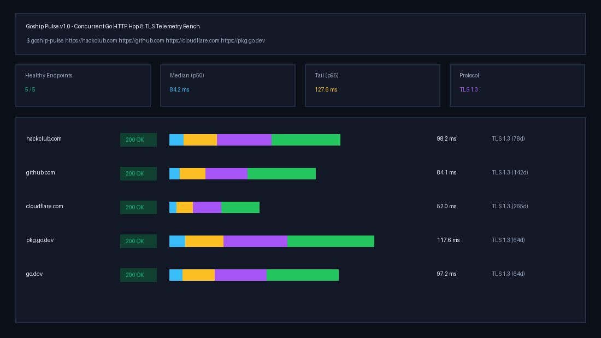

# Goship Pulse

A concurrent Go HTTP hop-timing waterfall benchmark and TLS certificate expiry inspector built with Go's standard library (`net/http/httptrace`, `crypto/tls`, and `sync.WaitGroup`).



## Features

- **Zero-Dependency Standard Library Core** Uses `net/http/httptrace.ClientTrace` hooks (`DNSStart`, `ConnectStart`, `TLSHandshakeStart`, `GotFirstResponseByte`) to measure microsecond-accurate DNS lookup, TCP handshake, TLS negotiation, and Server TTFB latency across multiple endpoints concurrently
- **TLS Cipher & Certificate Expiry Inspection** Inspects the negotiated TLS version (`TLS 1.3` / `TLS 1.2`), cipher suite, and leaf certificate expiration horizon in days
- **Terminal ASCII Waterfall & JSON Output** Renders a formatted box-drawing waterfall table in the terminal or emits structured JSON (`-json`) with `p50`, `p95`, and `max` latency percentiles
- **Embedded Live HTTP Dashboard (`-serve`)** Serves an interactive browser waterfall dashboard and `/api/probe` JSON endpoint

## Quick Start

```bash
# Run terminal waterfall probe across default endpoints
go run main.go

# Probe custom targets and output structured JSON
go run main.go -json https://hackclub.com https://github.com https://pkg.go.dev

# Launch the interactive web telemetry dashboard on port 8080
go run main.go -serve 127.0.0.1:8080
```

## Prebuilt Release Binaries

Cross-compiled standalone binaries for Linux (`amd64`), macOS (`arm64` / `amd64`), and Windows (`amd64`) are published on the [GitHub Releases](https://github.com/draarivpatel-ui/goship-pulse/releases/tag/v1.0.0) page.
